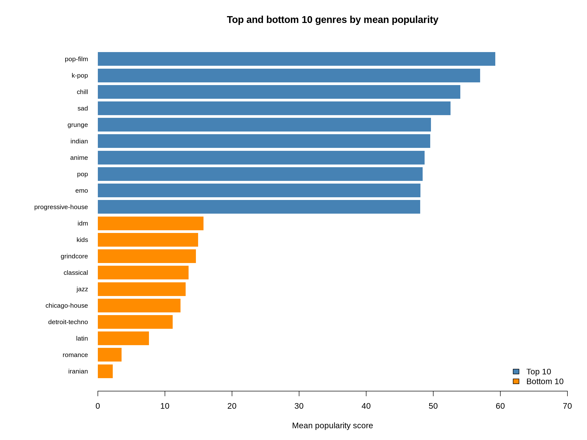
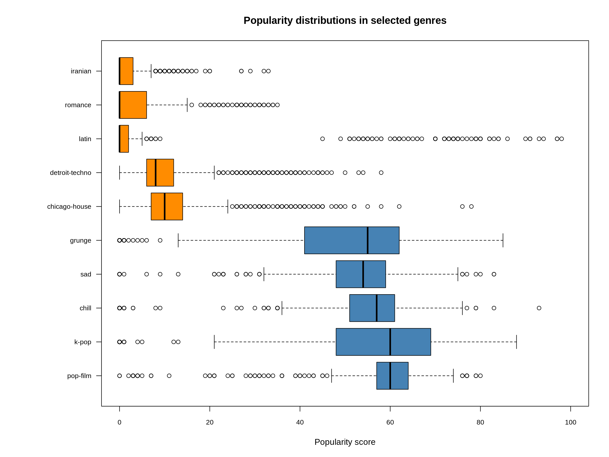
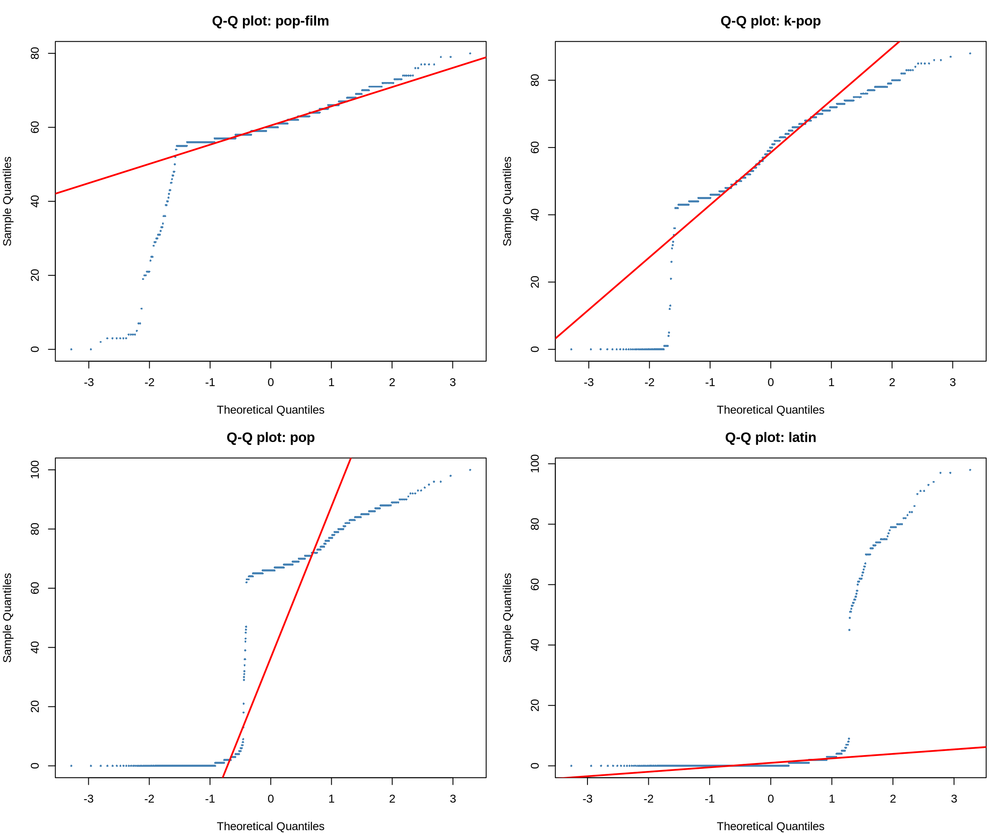

# Spotify Genre Popularity Analysis (R)

An R-based analysis of how track-popularity scores differ across 114 genre labels. The project combines data validation, descriptive statistics, visual exploration, a genre-level linear model, track-clustered robust inference, and multiple-comparison-adjusted pairwise tests.

> **Project context:** Individual Objective 1 contribution to a university Programming for Data Analytics (PDFA) coursework project. This repository documents the analysis work; it does not claim that the entire group assignment was completed individually.

## Results at a glance

| Measure | Result |
|---|---:|
| Track–genre rows analysed | 111,361 |
| Unique track IDs | 88,835 |
| Genre labels | 114 |
| Track IDs assigned to multiple genres | 15,536 (17.49%) |
| Maximum genre labels for one track ID | 9 |
| Genre-only model R² | 0.2579 |
| Overall clustered Wald test | 166,278.23 (113 df), *p* < 0.001 |
| Pairwise genre comparisons | 6,441 |
| Comparisons significant after Holm adjustment | 5,326 |
| Highest mean popularity | `pop-film` — 59.26 |
| Lowest mean popularity | `iranian` — 2.22 |

These results are from the successful local run of `analysis/03_obj1_genre_ahad.R`. The p-value shown as `< 0.001` is a reporting threshold, not an assertion that the probability is exactly zero.

## Questions explored

- How is the dataset distributed across genre labels?
- Which genre labels have the highest and lowest average popularity scores?
- How do popularity distributions compare for selected high- and low-mean genres?
- Is there an overall difference in mean popularity across genre labels?
- Which pairs of genre means have the largest estimated differences, and which remain statistically significant after multiple-comparison adjustment?

## Dataset and validation

The analysis uses `data/obj1_genre_popularity.csv` and requires the following columns:

- `track_id` — track identifier used to identify repeated tracks.
- `track_genre` — genre label associated with the row.
- `popularity` — integer popularity score, ranging from 0 to 100 in the supplied data.

The supplied file contains 111,361 track–genre rows and 88,835 unique track IDs. A track can appear under more than one genre label: 15,536 IDs (17.49%) appear in multiple genres, and one ID appears under as many as nine labels. The script checks the required columns, missing values in those columns, numeric popularity values, and duplicate `track_id`–`track_genre` pairs before analysis.

**Data provenance and licence:** The source URL, original publisher/uploader, and redistribution licence were not included with the project materials available for this README. Verify and record those details before publishing the raw CSV to a public repository. If redistribution is not permitted, omit the CSV from GitHub and provide instructions for obtaining it from its authorised source.

## Analysis workflow

1. **Validate the input:** check required fields, missing values, popularity type, and duplicate track–genre pairs.
2. **Describe the genres:** calculate the number of rows, mean, median, standard deviation, first quartile, and third quartile for each genre.
3. **Inspect repeated tracks:** count unique track IDs, IDs assigned to multiple genres, and the maximum number of genre labels per ID.
4. **Visualise the results:** create a top/bottom-ten mean comparison, boxplots for the five highest- and five lowest-mean genres, and Q–Q plots for four selected genres.
5. **Fit a genre-only linear model:** estimate `popularity ~ track_genre` using `lm()`.
6. **Use track-clustered inference:** estimate an HC1 cluster-robust covariance matrix by `track_id`, then conduct an overall Wald test of the genre effects.
7. **Compare genre pairs:** estimate all 6,441 pairwise mean contrasts, calculate two-sided large-sample z-test p-values, apply the Holm adjustment, and calculate Bonferroni simultaneous 95% confidence intervals.

### Why cluster by `track_id`?

The same track ID can contribute rows to more than one genre. Treating all track–genre rows as independent could understate uncertainty. The script therefore clusters the model covariance by track ID using `sandwich::vcovCL()` with the HC1 adjustment. This adjusts the covariance estimate for within-track dependence; it does not make genre labels mutually exclusive or remove every possible source of bias.

### P-value reporting

The script calculates very small tail probabilities in log form and applies the Holm adjustment in log space. The CSVs contain readable p-value fields (for example, `< 0.001`) alongside log-probability fields. Convenience numeric probability columns are also exported, but an extremely small value can underflow to numeric zero in ordinary floating-point representation. Such a zero is a computer representation limit, not an exact probability of zero; use the corresponding log field and readable report field when interpreting these results.

## Findings and interpretation

- `pop-film` has the highest observed mean popularity score (59.26) among the 114 genre labels in this dataset.
- `iranian` has the lowest observed mean (2.22).
- The genre-only model has an R² of approximately 0.2579. In this sample, genre labels account for about 25.8% of the variation represented by this model; this is an in-sample model statistic, not a measure of performance on unseen data.
- The overall clustered Wald test reports *p* < 0.001, providing evidence that not all genre means are equal under the fitted model and its covariance estimator.
- Of the 6,441 pairwise comparisons, 5,326 have Holm-adjusted p-values below 0.05.

These are associations within the supplied dataset. They do **not** show that a genre label causes a track to become more or less popular.

## Visualisations

### Mean popularity: top and bottom ten genres



### Popularity distributions: selected high- and low-mean genres



### Q–Q plots: selected genre distributions



The Q–Q plots show the raw popularity distributions for `pop-film`, `k-pop`, `pop`, and `latin`. They are exploratory distribution checks, not Q–Q plots of the fitted model's residuals.

## Run the analysis

### Requirements

- R
- The CRAN package [`sandwich`](https://cran.r-project.org/package=sandwich)
- The dataset at `data/obj1_genre_popularity.csv`

Install the package once if it is not already available:

```r
install.packages("sandwich")
```

Open the `PDFA_R_Analytics` folder as the working folder in Positron or another R environment. Run the script from that folder:

```r
source("analysis/03_obj1_genre_ahad.R")
```

Alternatively, from a terminal opened at the project root:

```bash
Rscript analysis/03_obj1_genre_ahad.R
```

The script reads from `data/` and creates or overwrites the generated reports in `outputs/`.

## Generated outputs

| File | Contents |
|---|---|
| `obj1_genre_summary.csv` | Per-genre sample sizes and descriptive statistics |
| `obj1_track_structure.csv` | Track reuse across genre labels |
| `obj1_top_bottom_genres.png` | Mean popularity for the top and bottom ten genres |
| `obj1_selected_genre_boxplots.png` | Popularity distributions for selected genres |
| `obj1_genre_qq_plots.png` | Q–Q plots for four selected genre distributions |
| `obj1_overall_genre_test.csv` | Overall clustered Wald test and p-value reporting fields |
| `obj1_pairwise_genre_comparisons.csv` | All pairwise contrasts, p-values, Holm adjustments, and confidence intervals |
| `obj1_largest_genre_differences.csv` | Ten largest absolute estimated genre differences |
| `obj1_key_results.csv` | Compact summary of key analysis results |

## Limitations

- **Observational data:** the analysis identifies differences and associations, not causal effects.
- **Overlapping genre membership:** one track may appear under multiple labels. Clustered covariance accounts for repeated track IDs in inference, but the genre groups still overlap in their membership.
- **Limited predictors:** the model includes genre only. It does not adjust for artist, release date, track characteristics, promotion, playlist exposure, or other potential factors.
- **Popularity score characteristics:** the score is bounded and discrete. The Q–Q plots are descriptive diagnostics for selected raw distributions; they do not alone establish whether the linear model is appropriate.
- **Model scope:** R² is calculated on the analysed data. No holdout set or out-of-sample predictive evaluation is part of this analysis.
- **Data provenance:** the dataset's original source and reuse licence still need to be verified before public redistribution.

## My contribution

I wrote most of the R analysis for this Objective 1 component. My work included input checks, descriptive summaries, visualisations, the genre-level linear model, track-ID-clustered robust inference, pairwise comparisons, Holm adjustment, and export of the results. I can explain the repeated-track issue, the statistical workflow, and the limits of the findings.

---

*This README describes the Objective 1 analysis artefact, not the full PDFA group submission. Update the dataset source and licence details before making the repository public.*
